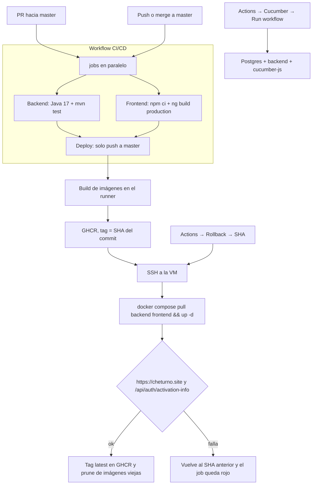

# CI/CD de CheTurno

El código se integra en GitHub Actions. Las imágenes se arman ahí, se publican en GHCR y el servidor solo las baja. La VM tiene 1 GB de RAM: no compila.

Hay tres workflows:

| Workflow | Cuándo corre | Qué hace |
| --- | --- | --- |
| [CI/CD](../.github/workflows/ci-cd.yml) | Cada PR a `master`, y cada push a `master` | Compila y testea. En un push a `master`, si eso pasó, despliega. |
| [Rollback](../.github/workflows/rollback.yml) | Manual (`workflow_dispatch`) | Vuelve a poner en el servidor un SHA que ya está en GHCR. |
| [Cucumber](../.github/workflows/cucumber.yml) | Manual | Levanta Postgres + backend y corre `testing/`. Hoy no es un check obligatorio. |



## Qué hace cada job

### Backend (Maven)

`mvn test` con Temurin 17. Hoy no hay clases en `src/test`: el job igual compila las 181 clases de `src/main` y Surefire termina con `No tests to run`. Eso es éxito. El día que haya un test, este mismo job lo corre. Si ese test levanta el contexto de Spring, va a necesitar Postgres; la base de Cucumber es el lugar para eso.

### Frontend (Angular)

`npm ci` y `npm run build -- --configuration production` con Node 20. El build de producción reemplaza `environment.ts` por `environment.prod.ts`, donde `apiUrl` es `'/api'`.

No hay tests unitarios de Angular: `angular.json` no tiene target `test`, los schematics están con `skipTests` y no hay `*.spec.ts`. Sumar Karma solo para tener un check vacío no aporta. Cuando existan, el comando es:

```bash
cd frontend/cli
npm test -- --watch=false --browsers=ChromeHeadless
```

El job también corre `scripts/check-prod-api-prefix.sh` y, después del build, revisa que `dist/cli/browser` exista y que el bundle no contenga el literal `/api/api`.

### Deploy (master)

Se salta en los PR (`if: push && master`) y espera a que Backend y Frontend terminen bien.

1. Arma las imágenes con los Dockerfiles del repo (multi-stage). No usa la VM para compilar.
2. Las sube a GHCR con el SHA del commit:
   - `ghcr.io/lohseagus/turneroweb-backend:<sha>`
   - `ghcr.io/lohseagus/turneroweb-frontend:<sha>`
3. Por SSH copia al servidor `docker-compose.yml`, `Caddyfile` y `remote-deploy.sh`. No copia ni pisa `.env`.
4. En la VM: `docker login ghcr.io` con el `GITHUB_TOKEN` de este job, `docker compose pull` de backend y frontend, `up -d`. El proyecto se llama `cheturno`. Postgres y Caddy no se vuelven a bajar en cada deploy.
5. Health check, hasta 5 minutos:
   - `GET https://cheturno.site/` responde 200 y el HTML tiene `<app-root` (el frontend).
   - `GET https://cheturno.site/api/auth/activation-info` responde 200 y el JSON trae `"status_code": 200`. Es un GET público de `AuthController`: no pide login y no escribe nada. `GET /` del backend también dice "Server Online", pero Caddy manda `/` al frontend; por eso el chequeo del backend va por `/api/...`.
6. Si respondió, guarda el SHA en `/home/ubuntu/cheturno/.deployed-sha`, borra imágenes que ningún contenedor usa y recién ahí mueve el tag `latest` en GHCR.
7. Si no respondió, vuelve al SHA de `.deployed-sha` y **el job queda rojo igual**. En el primer deploy no hay SHA anterior: restaura el `docker-compose.yml` y el `Caddyfile` que había en el servidor (copia en `.previous-config/`) y hace `up -d`.

`latest` no se mueve si el health check falló. Un rollback manual tampoco lo mueve: el servidor queda en el SHA que le pediste y `latest` sigue apuntando al último deploy sano.

## Ruta `/api` del frontend

Caddy recibe `https://cheturno.site/api/...` y lo reenvía a `backend:8080` **sin sacarle el prefijo**. Los controllers están en `/api/...` (`@RequestMapping("/api/auth")`, etc.). Nginx, dentro de la imagen del frontend, solo sirve la SPA.

`environment.prod.ts` define `apiUrl: '/api'`. Los servicios arman `` `${environment.apiUrl}/recurso` ``, que queda en `/api/recurso`. No hay que anteponer otro `/api`.

`registro.service.ts` hacía `` `${environment.apiUrl}/api/auth` `` y en producción pegaba a `/api/api/auth`. Quedó igual que login, activación y recupero de contraseña: `` `${environment.apiUrl}/auth` ``. En desarrollo sigue en `rest/api/auth` (el proxy de `ng serve` reescribe `/rest` → `/api`).

## Secrets

Se cargan a mano en **Settings → Secrets and variables → Actions → New repository secret**. Ninguno va al repo.

| Secret | Valor |
| --- | --- |
| `SSH_HOST` | IP o hostname de la VM. Sin `https://` y sin usuario. |
| `SSH_USER` | `ubuntu` |
| `SSH_PRIVATE_KEY` | La clave privada completa, incluida la línea `BEGIN` y la `END`. Tiene que ser la pareja de una pública que esté en `/home/ubuntu/.ssh/authorized_keys`. Sin passphrase: el runner no puede escribirla. |

No hace falta un PAT para GHCR. El job de deploy usa `secrets.GITHUB_TOKEN` (lo genera Actions para esa corrida) para dos cosas: subir las imágenes y, por SSH, `docker login ghcr.io` en la VM. El token muere cuando termina el job. `remote-deploy.sh` hace `docker logout` al salir y no lo escribe en `.env`.

Para que ese token pueda publicar paquetes, en **Settings → Actions → General → Workflow permissions** tiene que estar **Read and write permissions**. Si queda en solo lectura, el push a GHCR responde 403.

Los paquetes quedan privados y ligados al repo por el label `org.opencontainers.image.source`. El mismo token los puede bajar. Si en algún deploy el `docker login` de la VM rechaza el `GITHUB_TOKEN`, el plan B es:

1. GitHub → Settings → Developer settings → Personal access tokens → Tokens (classic).
2. Scope `read:packages`.
3. Guardarlo como secret `GHCR_PULL_TOKEN`.
4. En `.github/workflows/ci-cd.yml` y `.github/workflows/rollback.yml`, cambiar `GHCR_TOKEN: ${{ secrets.GITHUB_TOKEN }}` por `GHCR_TOKEN: ${{ secrets.GHCR_PULL_TOKEN }}`.

No pongas el token en el repo ni en el `.env` del servidor.

## Preparar el servidor, una sola vez

El directorio `/home/ubuntu/cheturno` ya existe y no es un clone de git. El workflow copia tres archivos ahí. Antes del primer merge:

1. Confirmar el volumen de Postgres, para no crear una base vacía:

   ```bash
   docker volume ls
   docker inspect cheturno-db --format '{{ range .Mounts }}{{ .Name }} -> {{ .Destination }}{{ println }}{{ end }}'
   ```

   Tiene que existir `cheturno_pgdata` montado en `/var/lib/postgresql/data`. El compose del repo fija ese nombre (`volumes.pgdata.name`). Si el volumen se llama distinto, cambiá ese `name:` en `docker-compose.prod.yml` **antes** de mergear, al nombre que mostró `docker volume ls`. No corras `docker volume rm` ni `docker compose down -v`.

   Los certificados de Caddy están en `cheturno_caddy_data` y `cheturno_caddy_config`. Esos nombres también están fijos.

2. Dejar el `.env` en `/home/ubuntu/cheturno/.env` con `DB_USERNAME`, `DB_PASSWORD`, `JWT_SECRET` y `MAIL_PASSWORD`. El ejemplo sin valores reales está en `deploy/.env.example`. El workflow no lo toca.

   - `JWT_SECRET`: Base64, 32 bytes o más (`openssl rand -base64 48`). El backend no arranca si falta, si es corta o si es la clave de ejemplo que estuvo publicada en el repo. Cambiarla cierra todas las sesiones: los usuarios vuelven a iniciar sesión.
   - `MAIL_PASSWORD`: contraseña de aplicación de la casilla que envía los mails. La imagen ya no trae ninguna. `MAIL_USERNAME` es opcional (por defecto `soporte.cheturno@gmail.com`).
   - `ADMIN_SEED_ENABLED`, `ADMIN_SEED_EMAIL`, `ADMIN_SEED_PASSWORD`: solo para una instalación nueva sin ningún SUPERADMIN. El seed viene apagado y exige una contraseña propia de 12 caracteres o más. Después del primer login, sacalas del `.env`.

   `remote-deploy.sh` revisa el `.env` antes de bajar imágenes. Si falta una de las cuatro obligatorias, o `JWT_SECRET` es la clave publicada, el deploy termina en rojo sin recrear contenedores y el sitio sigue con la versión anterior. Si `MAIL_PASSWORD` es la contraseña que estuvo publicada, deja un aviso en el log y sigue.

3. La clave pública correspondiente a `SSH_PRIVATE_KEY` tiene que estar en `/home/ubuntu/.ssh/authorized_keys` del usuario `ubuntu`.

4. `ubuntu` tiene que poder usar Docker. Probalo:

   ```bash
   docker info
   ```

   Si dice permission denied, o lo agregás al grupo (`sudo usermod -aG docker ubuntu`, y una sesión nueva) o dejás el sudo sin password que ya tiene. El script usa `sudo -n` solo si `docker info` falla.

5. No hace falta Java ni el repo en la VM. Docker y el plugin Compose v2 (`docker compose`, no `docker-compose`) ya están.

## Proteger `master`

Cuando este PR tenga el CI en verde, los checks ya existen y se pueden exigir. **Settings → Rules → Rulesets → New ruleset** (o **Settings → Branches → Add branch ruleset / classic protection**):

- Branch name: `master`.
- Restrict deletions y block force pushes.
- Require a pull request before merging. Sin eso se puede pushear directo y el CD despliega igual: el workflow también escucha `push`.
- Require status checks to pass:
  - `CI/CD / Backend (Maven)`
  - `CI/CD / Frontend (Angular)`

No marques `CI/CD / Deploy (master)`. En un PR ese job se salta a propósito, y un check obligatorio que quedó en skipped **bloquea el merge**.

Tampoco marques `Cucumber / Cucumber` hasta que la suite esté verde y la actives (abajo).

Conviene exigir las dos reviews que use la cátedra, si piden una. El resto (conversaciones resueltas, linear history) es opcional.

## Rollback

1. Actions → **Rollback** → Run workflow.
2. Branch: **master**. Si elegís otra, el job falla y no toca el servidor.
3. SHA: los 40 caracteres del commit bueno. Es el tag de la imagen en GHCR (Packages → `turneroweb-backend`). No sirve un SHA corto ni un commit que nunca se desplegó.
4. El workflow hace checkout de ese SHA, copia su compose y vuelve a correr `pull` + `up` + health check.

El tag `latest` no se mueve. El archivo `.deployed-sha` del servidor pasa a ese SHA solo si el health check responde.

## Cucumber, y cómo volverlo obligatorio

Hoy los steps pegan a `http://backend:8080/centrosAtencion` (sin `/api`) y el backend escucha en `/api/centrosAtencion`. Por eso el workflow es manual: Actions → **Cucumber** → Run workflow. Va a fallar hasta que ese otro PR deje las rutas alineadas, y no frena ningún merge.

Qué hace cuando lo corrés: Postgres 15 de servicio, `mvn package` del backend, `java -jar` con `SECURITY_DEV_MODE=true`, un alias `backend` → `127.0.0.1` (los tests tienen el host hardcodeado) y `npm test` en `testing/`.

Para hacerlo obligatorio, en `.github/workflows/cucumber.yml` descomentá:

```yaml
pull_request:
  branches: [master]
push:
  branches: [master]
```

Mergeá eso cuando una corrida manual esté verde, y en la protección de `master` agregá el check `Cucumber / Cucumber`.

## Qué no entra en este pipeline

Quedan anotados y no se tocaron, salvo el doble `/api` del registro, que impedía que el frontend publicado pegue al backend:

- `SecurityConfig` en modo producción autoriza rutas **sin** `/api` (`/turnos/**`, `/agenda/**`, `/pacientes/**`, ...). Los controllers viven en `/api/...`, así que esas reglas no matchean. Termina aplicando `anyRequest().authenticated()`. El control por rol no está donde parece.
- `application.properties` ya no trae secretos por defecto, pero la clave JWT de ejemplo, la contraseña SMTP y la clave del admin seed siguen en el historial de git. Sacarlas del archivo no las invalida: hay que revocar la contraseña de aplicación en la cuenta de Google, cambiar la contraseña de `admin@turneroweb.com` si esa cuenta existe en producción y confirmar que el `JWT_SECRET` del servidor no es la clave de ejemplo.
- No hay tests unitarios de backend ni de Angular.
